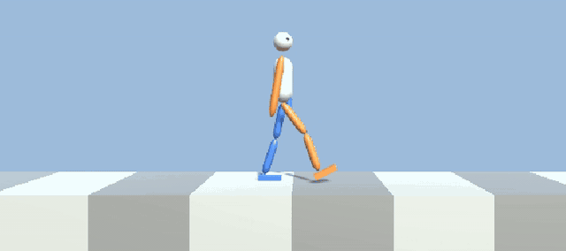

# Stickman Walker

A 2D stickman, seen from the side, that learns to walk like a human with **PPO** and **Unity ML-Agents**. The body, the training areas and the scenes are generated by script in one click.



---

## Contents

1. [How it works](#1-how-it-works)
2. [Requirements](#2-requirements)
3. [Installation](#3-installation)
4. [Quick start](#4-quick-start)
5. [Scene and keyboard control](#5-scene-and-keyboard-control)
6. [Training](#6-training)
7. [Agent design](#7-agent-design)
8. [Configuration](#8-configuration)
9. [Known limitations and future work](#9-known-limitations-and-future-work)
10. [Project structure](#10-project-structure)

---

## 1. How it works

- **3D physics constrained to 2D:** each segment is a `Rigidbody` locked to the XY plane, and each joint is a `ConfigurableJoint` that only rotates around Z.
- **10-segment body** (≈ 70 kg, 1.74 m). Left limbs are blue, right limbs are orange.
- **The agent drives 8 joints** (hips, knees, ankles, shoulders) by setting their target angles.
- **16 training areas** run in parallel.
- **A 4-lesson curriculum**, from standing with help to walking at 1.3 m/s without help.

---

## 2. Requirements

| Component | Version |
|---|---|
| Unity | 6.3 LTS (6000.3.27f2) |
| com.unity.ml-agents | 4.2.0 |
| Python | 3.10 (3.10.1 to 3.10.12; 3.11+ does not work) |
| mlagents | 1.1.0 |
| torch | ≤ 2.8.0 |
| setuptools | < 81 |

---

## 3. Installation

### 3.1 Unity project
```bash
git clone https://github.com/ismailarrouchdi/StickmanWalker.git
```
Open the folder with Unity 6.3 LTS from Unity Hub (*Add > Add project from disk*). On the first opening, the scenes are built automatically and the demo scene is left open.

### 3.2 Python environment
From the project root:

**Windows (cmd):**
```bat
py -3.10 -m venv .venv
.venv\Scripts\activate
python -m pip install -r requirements.txt
```

**macOS / Linux:**
```bash
python3.10 -m venv .venv
source .venv/bin/activate
python -m pip install -r requirements.txt
```

Check with `mlagents-learn --help`.

---

## 4. Quick start

1. Open `Assets/Stickman/Scenes/StickmanDemo.unity`.
2. Press **Play**.

To watch another model, select its `.onnx` and run **Tools > Stickman > Build Demo Scene**.

---

## 5. Scene and keyboard control

**Tools > Stickman > Build Training Scene** creates the configuration, the prefab and the training scene with 16 areas. Rebuild it only after changing the body dimensions, the number of areas or the ground length.

**Keyboard:** press **Play** without running `mlagents-learn`.

| Joint | + | − |
|---|---|---|
| Left hip / knee / ankle / shoulder | Q W E R | A S D F |
| Right hip / knee / ankle / shoulder | U I O P | J K L ; |

Keys are QWERTY positions. **Camera:** Tab/N next agent, B previous, H hide the HUD.

---

## 6. Training

Run the commands from the project root, with the Python environment activated and the **StickmanTraining** scene open.

### 6.1 Full training
```bat
mlagents-learn Assets/Stickman/Config/StickmanWalker.yaml --run-id=stickman_01 --timeout-wait=300
```
Wait for **"Listening on port 5004"**, then press **Play**. A good gait usually appears around 4–5 M steps (about 15 min per million steps in the editor).

### 6.2 Fine-tuning
```bat
mlagents-learn Assets/Stickman/Config/StickmanWalker_FineTune.yaml --run-id=stickman_02 --initialize-from=stickman_01 --timeout-wait=300
```
Starts directly at 1.3 m/s without the curriculum.

### 6.3 Stopping and resuming
| Action | Command |
|---|---|
| Stop and save | **Ctrl+C** once |
| Resume | same command with `--resume` |
| Restart from scratch | `--force` (deletes the run) |

---

## 7. Agent design

- **Actions (8):** one target angle per joint, in [−1, 1]; 0 is the standing pose.
- **Observations (61):** torso and head state, velocities, joint angles and velocities, foot contacts and positions, gait phase, target speed and previous actions.
- **Rewards:**
  - matching the target speed (smoothed over 1 s) and moving forward;
  - upright posture and arm swing;
  - a bonus for each valid step, with the feet alternating;
  - penalties for energy, jerky moves, slipping, hopping and lifting a foot too high.
- **Episode ends** on a fall, after 30 s, or when the agent stops making progress.

---

## 8. Configuration

All parameters are in `Assets/Stickman/Config/StickmanConfig.asset` (**Tools > Stickman > Select Configuration**). Each field has a tooltip. The default values are those used to train the v06 model.

---

## 9. Known limitations and future work

- **Untested robustness:** flat ground, no pushes, fixed physics. Next step: random pushes and domain randomisation.
- **Single speed:** the model can neither change pace nor stop. Next step: a random target speed during the episode.
- **Heel lifts slightly too high** during swing. Next step: penalise knee flexion beyond 70°.
- **Hand-crafted reward:** some loopholes may remain. Next step: imitation from motion capture.

---

## 10. Project structure

```
StickmanWalker/
├── README.md
├── requirements.txt
├── docs/demo_v06.gif
├── Assets/Stickman/
│   ├── Scripts/        Agent, configuration, joints, camera, input
│   ├── Editor/         Tools > Stickman menu and first-opening setup
│   ├── Config/         StickmanConfig.asset and the two training YAML files
│   ├── Models/         StickmanWalker_v06.onnx and History/
│   └── Materials/, Prefabs/, Scenes/   Generated by the menu
├── Packages/manifest.json
└── ProjectSettings/
```
